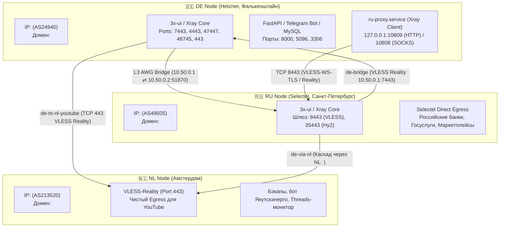
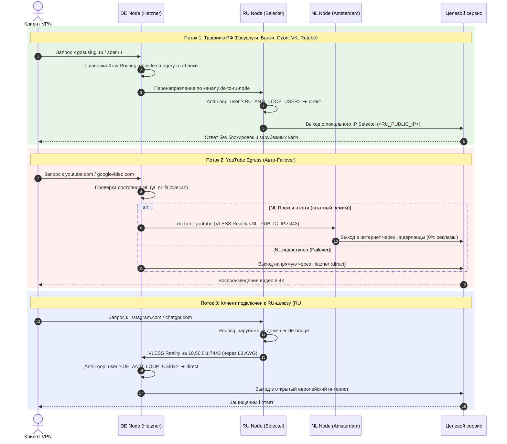

# Комплексная архитектура, связи, маршруты и потоки (Flows) VPN-Service

*Актуализировано: Ноябрь 2026 г. | Окружение: Production (Multi-Node) | Версия: Sanitized (OpSec Protected)*

---

## 1. Географическая топология узлов (Nodes)

Инфраструктура VPN-сервиса построена на 3 географически распределённых нодах, оптимизированных под надежность, обход ТСПУ и раздельную маршрутизацию.

### Сводная таблица серверов
| Узел | Провайдер / ASN | Публичный IP / Домен | Роль в системе | Внутренний IP |
|---|---|---|---|---|
| **Германия (DE)** | Hetzner (`AS24940`) | `<DE_PUBLIC_IP>` `<DE_DOMAIN>` | Ядро управления, биллинг, Telegram-бот, API подписок, основные зарубежные инбаунды | `10.50.0.1` |
| **Россия (RU)** | Selectel SPB (`AS49505`) | `<RU_PUBLIC_IP>` `<RU_DOMAIN>` | Российский шлюз, Split-Tunneling в РФ (банки, Госуслуги), эквайринг ЮKassa | `10.50.0.2` |
| **Нидерланды (NL)** | Global DC (`AS213520`) | `<NL_PUBLIC_IP>` `<NL_DOMAIN>` | Чистый транзит для YouTube (без рекламы/замедлений), off-site резервные копии | — |

---

## 2. Межсерверные каналы связи и туннели

### 2.1. Основной L3 Site-to-Site мост (`awg-ru-bridge` ⇄ `awg-de-bridge`)
- **Протокол**: AmneziaWG (ядерный модуль kmod).
- **Адресация**: `10.50.0.1/30` (DE) ⇄ `10.50.0.2/30` (RU).
- **Порт**: `51870/udp` (перенесён с 51850 из-за фильтрации диапазона ТСПУ).
- **MTU**: 1420.
- **Обфускация**: `Jc=4, Jmin=40, Jmax=70, S1=33, S2=47, H1..H4`.
- **Назначение**:
  1. Синхронизация клиентов через 3x-ui REST API (`https://10.50.0.2:2053`).
  2. Служебный сервисный канал и метрики между нодами.

### 2.2. Аварийный WebRTC туннель (`olcRTC`)
- **Служба**: `olcrtc.service` (`127.0.0.1:10808` SOCKS).
- **Логика работы**: Демон `de_bridge_failover.py` каждую минуту пингует `10.50.0.2`.
- **Триггер активации**: При потере L3-моста и отказе резервов скрипт поднимает туннель через публичные комнаты Jitsi (`tiinvpn_olcrtc_ru_XXXX`). При восстановлении моста автоматически глушит сервис.

### 2.3. Локальный клиентский прокси для ЮKassa (`ru-proxy.service`)
- **Проблема**: Hetzner IP заблокирован сервисами эквайринга РФ (`api.yookassa.ru` сбрасывает TLS).
- **Решение**: На DE поднят клиент Xray, слушающий `127.0.0.1:10809` (HTTP) и `127.0.0.1:10808` (SOCKS).
- **Транспорт**: Направляет трафик через Selectel SPB (`<RU_DOMAIN>:8443` VLESS-WS-TLS).
- **Защита в коде**: `bot_xui/yookassa_client.py` изолирует вызовы сокетным таймаутом (10с) и асинхронным `asyncio.wait_for(15s)`.

---

## 3. Реестр клиентских инбаундов (Inbounds Roster)

### 3.1. Германия (DE Node — Hetzner)
| Инбаунд ID | Протокол | Порт / Транспорт | Назначение / Оператор | Отображение в подписке |
|---|---|---|---|---|
| `#4` | **Hysteria2** | `4443/udp` (QUIC/BBR) | Универсальный: макс. скорость для всех операторов (52% трафика) | `🇩🇪 🚀 Hysteria2 • Turbo (Быстрый)` |
| `#1` | **VLESS-Reality** | `7443/tcp` (XTLS-Vision) | Основной TCP для МТС, Ростелеком, оптики (40% трафика) | `🇩🇪 👁️ Reality • Vision (МТС / РТК)` |
| `#2` | **VLESS-xHTTP** | `47447/tcp` (xHTTP/SplitHTTP) | Стойкий xHTTP против ТСПУ на сети МегаФон | `🇩🇪 🌊 xHTTP • Stream (МегаФон)` |
| `#15` | **VLESS-xHTTP** | `48745/tcp` (xHTTP Armor) | Резервный бронебойный xHTTP для МТС / Билайн | `🇩🇪 💎 xHTTP • Armor (МТС / Билайн)` |
| `#10` | **VLESS-Reality** | `53151/tcp` (XTLS-Vision) | Резервный Reality TCP (SNI Deutsche Bahn) | `🇩🇪 🛡️ Reality • Standard (Bahn)` |
| `#16` | **Hysteria2** | `35443/udp` | Резервный Hysteria UDP | `🇩🇪 ⚔️ Hysteria2 • Armor-M1` |
| `#17` | **AmneziaWG** | `443/udp` (AWG) | Клиентский Split-Tunneling (Google, AI, Meta, X, Discord) | `🇩🇪 ⚡ AmneziaWG • App` |

### 3.2. Россия (RU Gateway — Selectel SPB)
| Инбаунд ID | Протокол | Порт / Транспорт | Назначение | Отображение в подписке |
|---|---|---|---|---|
| `RU #1` | **VLESS-WS-TLS** | `8443/tcp` (Websocket/TLS) | Шлюз РФ с полным сплит-туннелингом (РФ локально, мир через DE) | `🇷🇺 🛡️ XHTTP • Шлюз (РФ ➔ DE)` |
| `RU #2` | **Hysteria2** | `35443/udp` (QUIC) | Скоростной шлюз РФ для мобильных сетей | `🇷🇺 ⚡ Hysteria2 • Шлюз (РФ ➔ DE)` |

---

## 4. Маршрутизация трафика и сквозные потоки (Traffic Flows)

### 4.1. Детальная матрица маршрутизации Xray (Routing Matrix)

#### На ноде в Германии (DE Node):
1. **Блокировки безопасности**:
   - Порты спама и уязвимостей (`25, 465, 587, 135, 137, 138, 139, 445`) ➔ `blocked`.
   - Входящий протокол `BitTorrent` ➔ `blocked`.
   - Исходящий `udp:443` (QUIC) ➔ `blocked` (для принудительного мгновенного отката браузеров на TCP XTLS-Vision, устраняет задержки Instagram/YouTube).
   - Государственные системы слежения/блокировок (`cmu.ssop.gov.ru`, `eais.rkn.gov.ru`, `ooni.org` и т.д.) ➔ `blocked`.
2. **Маршрутизация YouTube (`yt_nl_failover.sh`)**:
   - `youtube.com`, `googlevideo.com`, `ytimg.com`, `geosite:youtube` с инбаунда `#17` (AWG) ➔ `direct`.
   - Те же домены с остальных инбаундов ➔ `de-to-nl-youtube` (VLESS-Reality на `<NL_PUBLIC_IP>:443`, Нидерланды).
   - При отказе NL-ноды сторож переключает тег на `direct`.
3. **Маршрутизация российского трафика (`de-to-ru-node`)**:
   - Банки: Сбер, Т-Банк, Альфа, ВТБ, Газпромбанк, ЦБ РФ, СБП, Мир.
   - Госсервисы: Госуслуги, ЕГИСЗ, Налог.ру, Мос.ру, Е-Якутия.
   - Маркетплейсы: Ozon, Wildberries, Авито, СДЭК, Яндекс.Маркет, 2ГИС.
   - Операторы: МТС, МегаФон, Билайн, Т2, Ростелеком.
   - Все они пересылаются на RU-ноду через `de-to-ru-node`.
4. **Защита от петель (Anti-Loop)**:
   - Соединения от пользователя `<DE_ANTI_LOOP_USER>` (трафик, пришедший из РФ через мост) безусловно идут в `direct` (Европа) и не могут повторно уйти в РФ.

#### На ноде в России (RU Node — Selectel):
1. **Локальный трафик (`direct`)**:
   - `.ru`, `.su`, `.рф`, `geosite:category-ru`, `geosite:category-gov-ru`, `geoip:ru`, `rutube.ru`, `vk.com` выходят локально в Selectel SPB.
   - Пользователь `<RU_ANTI_LOOP_USER>` (запросы из Германии через мост) безусловно направляется в `direct`.
2. **Зарубежный трафик (`de-bridge`)**:
   - `geosite:youtube`, `netflix`, `chatgpt`, зарубежные IP направляются через L3-мост на `10.50.0.1:7443` (Hetzner DE).
3. **Аварийный зарубежный обход (`de-via-nl`)**:
   - В случае проблем на прямом плече трафик может быть отправлен каскадом через Нидерланды (`out-nl-direct`).

---

## 5. Системные службы и демоны автоматизации

| Служба / Скрипт | Расписание / Запуск | Файлы состояния / Логи | Что делает |
|---|---|---|---|
| `awg-quick@awg-ru-bridge` | Systemd 24/7 | `/etc/amnezia/amneziawg/awg-ru-bridge.conf` | Поднимает L3 AmneziaWG туннель к Selectel SPB (порт 51870) |
| `ru-proxy.service` | Systemd 24/7 | `127.0.0.1:10809` (HTTP), `10808` (SOCKS) | Клиентский прокси Xray для ЮKassa и скриптов к сервисам РФ |
| `inbound-switch-monitor.service` | Systemd 24/7 (демон) | `data/inbound_switches.json` `logs/inbound_switches.log` | Анализирует `/var/log/x-ui/access.log`, логирует переключения операторов связи |
| `olcrtc.service` | Systemd (по вызову сторожа) | `/home/alvik/olcrtc/olcrtc` | Аварийный WebRTC-туннель через Jitsi |
| `de_bridge_failover.py` | Cron: каждую минуту | `/home/alvik/logs/de_bridge_failover.log` `data/de_bridge_state` | Проверяет пинг `10.50.0.2`. При обрыве запускает `olcrtc.service` |
| `yt_nl_failover.sh` | Cron: каждые 5 минут | `logs/yt-failover.log` `data/yt_nl_proxy_state` | Проверяет связность с NL YouTube proxy. Переключает на direct при отказе |
| `sync_ru_node.py` | Cron: каждый час | `logs/ru_sync.log` | Синхронизирует клиентов (UUID, subId, expiryTime, enable) с RU 3x-ui |
| `sync_threat_blocklist.py` | Cron: каждый час (:15) | IPSet `tiin-threats` (DE ⇄ RU ⇄ NL) | Синхронизирует заблокированных сканеров/ботов между всеми серверами |
| `migrate_selectel_direct.py` | Cron: каждые 30 минут | `logs/selectel_migration.log` | Мониторит связность моста с Selectel и число клиентов |
| `run_qa_agent.sh` | Cron: ежедневно 04:15 | `qa_agent/reports/` | Ночной E2E-аудит (MTProto бот, сеть Xray, оплата) с отчетом в Telegram |
