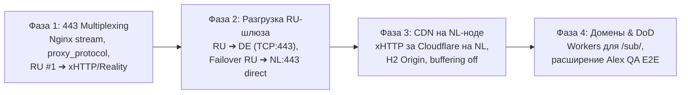

# Техническое задание (ТЗ): Усиление архитектуры VPN-Service до уровня 9.5 / 10

*Ветка разработки: `dev` | Статус: Утверждено (v2.1 Production-Ready)*

---

## Цели модернизации
Устранение уязвимостей перед жесткими практиками ТСПУ (ковровые блокировки автономных систем `AS24940` Hetzner, фильтрация высоких нестандартных портов, «эффект 16 КБ», деградация межсерверного UDP, зависимость от одного хостинг-провайдера).

---

## 1. Консолидация инбаундов на `443/tcp` и Nginx Stream

### 1.1. Передача реальных IP клиентов (`proxy_protocol`)
* В Nginx `stream` директива `proxy_protocol on;` действует на upstream-соединение внутри блока `server {}`.
* **Изоляция и совместимость**:
  * Для Xray-инбаундов активируется `acceptProxyProtocol: true`.
  * Если через тот же Nginx stream на 443/tcp проходят веб-сервисы (FastAPI, Webhook, подписки, 3x-ui), их `http`-блоки обязаны содержать `listen ... proxy_protocol;` + `set_real_ip_from 127.0.0.1; real_ip_header proxy_protocol;` либо разделяться по отдельным изолированным upstream/server блокам.
  * Fallback-заглушка на `127.0.0.1:8443` также обязана принимать `proxy_protocol`, исключая искажение TLS handshake.
* **Верификация**: контроль сохранения реальных IP абонентов в `/var/log/x-ui/access.log` для работы аналитики `inbound-switch-monitor.service` и предотвращения ложных банов `127.0.0.1` в `sync_threat_blocklist.py`.

### 1.2. Локальный транспорт: `127.0.0.1:<port>` с Proxy Protocol
* В качестве транспорта между Nginx и Xray используются локальные TCP loopback-порты (`127.0.0.1:20443`, `127.0.0.1:20444` и др.).
* **Разделение внешнего и внутреннего порта**:
  * В 3x-ui инбаунд создаётся на локальном порту (например, `127.0.0.1:20443`).
  * В генераторе подписок (`bot_xui/sub_builder.py`) для клиента **строго подставляется внешний порт 443** и соответствующий публичный SNI из таблицы маппинга Nginx `map $ssl_preread_server_name`.
  * Старые боевые инбаунды (`7443`, `47447`, `8443`) на время Dual-Run не модифицируются; новые инбаунды на 443 создаются рядом параллельными записями.

### 1.3. Обработка соединений без SNI / с неизвестным SNI
* В блоке `map $ssl_preread_server_name` входящий TLS-трафик направляется:
  * Запросы с легитимными SNI инбаундов ➔ в соответствующий локальный порт Xray.
  * Запросы без SNI (подключение по голому IP) или с неизвестным SNI ➔ перенаправляются на дефолтный локальный **HTTPS**-сервер (`127.0.0.1:8443` с директивой `ssl_reject_handshake on;` либо веб-заглушкой с валидным доменным TLS-сертификатом).
* **Запрет**: сырой входящий TLS-трафик категорически запрещено пересылать на plain-HTTP порт (порт 80), что исключает формирование мусорных TCP-ответов и сбросов.

---

## 2. Разгрузка и модернизация RU-шлюза (Selectel SPB)

### 2.1. Прямой зарубежный выход `RU ➔ DE:443` (без L3 UDP-инкапсуляции)
* Пользовательский зарубежный трафик с RU-ноды (`de-bridge`) переводится с AmneziaWG (`10.50.0.1:7443`) на прямое TCP-подключение к `DE:443` (VLESS-Reality / xHTTP).
* **Аварийный резервный маршрут**: при недоступности прямого плеча в Германию трафик переключается на **`RU ➔ NL:443 ➔ direct`** (выход в открытый интернет напрямую через Нидерланды, минуя транзитный крюк в DE).
* **Механизм переключения**:
  * Реализация через секции Xray **`observatory` + `balancer`** (автоматический RTT health check и переключение на уровне ядра с нулевой задержкой).
  * **Эксплуатационное требование**: секции `observatory` и `balancer` на RU-ноде прописываются строго через **Xray Config Template (`xrayTemplateConfig`)** в базе данных 3x-ui, чтобы исключить затирание конфигурации при штатных синхронизациях через `sync_ru_node.py`.

### 2.2. Защита от маршрутных петель (Anti-Loop)
* На DE-ноде для входящих соединений с RU-ноды фиксируется выделенный `email`/user-тег (`<DE_ANTI_LOOP_USER>`).
* В правилах маршрутизации Xray на DE этот тег безусловно направляется в `direct` (Европа), исключая повторный разворот трафика в сторону `de-to-ru-node`.

### 2.3. Модернизация клиентского инбаунда `RU #1`
* Клиентский инбаунд `RU #1` переводится с устаревшего `VLESS-WS-TLS` (порт `8443`) на современный **`VLESS-xHTTP`** или **`VLESS-Reality`** на порту **`443/tcp`**.

### 2.4. Служебный L3-мост: апгрейд до AmneziaWG 1.5+ (CPS `I1–I5`)
* L3-мост AmneziaWG (`51870/udp`) остаётся строго изолированным для служебных задач: REST API 3x-ui (`https://10.50.0.2:2053`), мониторинг, телеметрия.
* **Требование к апгрейду**: перед внедрением параметров `I1–I5` (маскировка старта туннеля под QUIC/DNS) обязательно выполняется проверка и обновление ядерного модуля `amneziawg-dkms` (`kmod`) и пакета `amneziawg-tools` **на обеих нодах (DE и RU)**, предотвращая сбой `awg-quick` при перезапуске со старым модулем.

### 2.5. Плечо `DE ➔ RU` (`de-to-ru-node`)
* Маршрутизация трафика к российским банкам и Госуслугам с DE на RU переводится на прямое защищенное TLS-соединение к `RU:443`, исключая зависимость критических сервисов от стабильности UDP-моста.

---

## 3. Инбаунд xHTTP за CDN (Cloudflare / Gcore) и асимметричная маршрутизация

### 3.1. Размещение xHTTP за CDN на узле Нидерланды (NL)
* Входная точка xHTTP за CDN размещается непосредственно на ноде **Нидерланды (`<NL_PUBLIC_IP>`)**.
* **Обоснование архитектуры**:
  * Xray xHTTP связывает upload и download потоки сессии в оперативной памяти **одного экземпляра ядра**.
  * Размещение на NL обеспечивает чистую схему: **Upload идёт `Клиент ➔ CDN ➔ NL`**, а **Download — `Клиент ➔ NL (direct)`**.
  * Это исключает необходимость построения сложных промежуточных реверс-прокси, обеспечивает минимальный RTT и полностью убирает CDN-инбаунд из-под зависимости от Hetzner (`AS24940`).
* **Плечо CDN ➔ Origin**: строго по **HTTP/2** с валидным **Origin CA Certificate**.
* **Директивы Nginx на NL**:
  * `proxy_buffering off;`
  * `proxy_request_buffering off;`
  * (Обязательно для потоковой передачи SplitHTTP без задержек и таймаутов).

---

## 4. Диверсификация автономных систем (Защита от бана `AS24940` Hetzner)

### 4.1. Разнесение входных клиентских точек (Multi-ASN Inbounds)
* Вынести 1–2 прямых клиентских инбаунда (VLESS-Reality / Hysteria2) на:
  * **Узел Нидерланды (NL)**: `<NL_PUBLIC_IP>` (`AS213520`) — независимый европейский ASN без репутационных ограничений.
  * **Резервный VPS (Standby Egress)**: резервный узел у независимого провайдера вне «токсичной пятёрки» (Hetzner, OVH, DigitalOcean, AWS, GCP).

### 4.2. Изоляция доменных зон и защита сервиса подписок
* Разнести инфраструктурные домены: RU-шлюз, NL-узел и сервис подписок не должны делить одну родительскую зону `<OLD_ROOT_DOMAIN>`.
* **Защита URL подписок (`/sub/...`)**:
  * Вынести раздачу подписок за Cloudflare Workers или резервный прокси-домен с авто-failover.
  * Клиенты гарантированно сохранят возможность обновить конфигурации при полной блокировке IP Hetzner.

### 4.3. Standby-резерв для платежей (ЮKassa)
* Подготовить конфигурацию запасного egress-прокси у альтернативного хостера в РФ для службы `ru-proxy.service` на случай регуляторных санкций в отношении Selectel SPB.

---

## 5. Этапность внедрения (Phased Rollout)

| Фаза | Задачи | Риски и меры контроля |
|---|---|---|
| **Фаза 1** | Настройка Nginx Stream на `443/tcp`, привязка Xray к `127.0.0.1:<port>` с `proxy_protocol on;`, перевод `RU #1` на xHTTP | Контроль сохранения реальных IP в `access.log`; проверка `inbound-switch-monitor`. |
| **Фаза 2** | Перенос `de-bridge` на прямое подключение к `DE:443`, внедрение балансировщика Xray в `xrayTemplateConfig` с выходом на `NL:443 direct` | Проверка отсутствия петель (Anti-Loop); тест скорости и MTU без UDP-оверхеда. |
| **Фаза 3** | Развёртывание xHTTP за Cloudflare на NL-ноде (Origin CA, buffering off), интеграция инбаундов NL в подписку | Тест отдачи стриминга без буферизации Nginx; замер задержек CDN. |
| **Фаза 4** | Разнос доменных зон, вынос `/sub/` на Cloudflare Workers, расширение автотестов | Прогон расширенного E2E-сьюта Alex QA; проверка загрузки подписок с разных операторов. |

---

## 6. Zero-Downtime миграция (Параллельная работа)

1. **Параллельная работа 7–14 дней**:
   * Старые порты (`7443`, `47447`, `8443`, `35443`) остаются активными в Xray и фаерволе на протяжении 2 недель.
   * Новые инбаунды на `443/tcp` и CDN поднимаются параллельно.
2. **Плавная ротация подписок**:
   * Генератор подписок (`bot_xui/sub_builder.py`) переключается на выдачу новых конфигураций на 443 порту.
   * Клиентские приложения плавно обновляют настройки при периодических обращениях к подписке.
3. **Вывод старых портов**:
   * По истечении 14 дней скрипт мониторинга сверяет отсутствие активных сессий на устаревших портах, после чего они закрываются в UFW.

---

## 7. Критерии приёмки (Definition of Done — DoD)

1. **Корректность клиентской аналитики (`proxy_protocol`)**:
   * В `/var/log/x-ui/access.log` фиксируются реальные внешние IPv4/IPv6 абонентов, локальный адрес `127.0.0.1` отсутствует.
   * Служба `inbound-switch-monitor.service` корректно строит матрицу переключений операторов.
2. **Расширенные E2E-тесты Alex QA Sentinel**:
   * Тестовый набор `scripts/run_qa_agent.sh` **предварительно расширяется новыми сценариями** для валидации новых инбаундов (`443/tcp`, CDN, NL).
   * Выполнение `bash scripts/run_qa_agent.sh --full --report` завершается со статусом **100% PASS** по всем итерациям.
3. **Производительность и системные ресурсы**:
   * Отсутствие аномальной нагрузки на CPU/RAM: Nginx stream и Xray core не создают утечек файловых дескрипторов или буферизации в памяти.
4. **Отказоустойчивость и направления трафика**:
   * Имитация обрыва плеча **`RU ➔ DE` (`de-bridge`)**: уже открытые TCP-сокеты физически сбрасываются (физика TCP), но задача связки `observatory` + `balancer` — гарантировать, что в пределах `probeInterval` (10–30 с) все новые запросы и повторные подключения абонентов автоматически и прозрачно направляются на **`NL:443 ➔ direct`** без зависания и ручного вмешательства.
   * Плечо **`DE ➔ RU` (`de-to-ru-node`)**: российские сервисы (Госуслуги, Сбер, Т-Банк) стабильно открываются через RU-ноду по прямому TLS-каналу (HTTP 200).
5. **Целостность платежей**:
   * Вызовы эквайринга ЮKassa через `ru-proxy.service` стабильно проходят с задержкой < 1.5 с.
